<div align="center">



# AegisTrace — Phishing Attack Detector

**A real-time URL and email phishing analysis workbench for security-minded users.**

[](https://www.typescriptlang.org/)
[](https://react.dev/)
[](https://nodejs.org/)
[](#license)

[Features](#features) · [Quick Start](#quick-start) · [Architecture](#architecture) · [Detection](#detection-methodology) · [Security](#security)

</div>

---

## Overview

AegisTrace inspects suspicious URLs, domains, TLS certificates, and email messages for phishing indicators. It combines lexical analysis, live DNS and RDAP data, TLS metadata, bounded HTTP behavior checks, and email authentication signals in one explainable interface.

The interface uses a strict charcoal-and-blue visual system with a live HTML5 canvas particle field. The particles react to pointer movement and accelerate while a scan is active.

> [!IMPORTANT]
> AegisTrace provides defensive triage and explainable evidence. It is not a replacement for a mature enterprise email gateway or browser security platform.

---

## Features

- **Live dashboard** — Total scans, verdict distribution, detection vectors, and recent activity sourced from real persisted reports.
- **URL scanner** — Animated four-stage lexical, DNS/RDAP, TLS, and bounded HTTP inspection pipeline.
- **Email analyzer** — Paste raw headers and content or upload `.eml` / `.txt` files for authentication and social-engineering analysis.
- **Explainable reports** — Radial risk gauge, weighted signal breakdown, DNS/TLS evidence, actions, and JSON/Markdown export.
- **Scan archive** — Search and filter previously generated reports.
- **Live particle field** — Interactive canvas network with mouse response and reduced-motion support.
- **SSRF protection** — Private, loopback, metadata, and unsupported targets are blocked before outbound probes.

---

## Detection Methodology

AegisTrace uses a bounded `0–100` risk model and presents the evidence behind every verdict.

| Category | Signals inspected |
| :--- | :--- |
| **URL Structure** | IP literals, `@` obfuscation, Punycode, homographs, deep subdomains, unusual ports, entropy, and credential keywords |
| **Brand Impersonation** | Lookalike normalization, Levenshtein distance, and protected-brand matches |
| **Domain Intelligence** | Live `A`, `AAAA`, `MX`, SPF, DMARC, registration age, suspicious TLD, and RDAP metadata |
| **TLS / HTTPS** | Live certificate issuer, SAN hostname match, protocol, expiry, trust state, and transport security |
| **HTTP Behavior** | Redirect chain, cross-domain redirects, password forms, and bounded HTML inspection |
| **Email Headers** | `From`, `Reply-To`, `Return-Path`, SPF, DKIM, DMARC, and display-name mismatches |
| **Email Content** | Urgency language, credential and financial requests, risky attachments, and anchor-text mismatches |

### Risk Classification

| Score | Verdict | Meaning |
| :---: | :--- | :--- |
| `0–29` | **Safe** | No significant indicators observed |
| `30–59` | **Suspicious** | One or more anomalous traits require verification |
| `60–100` | **Malicious** | A high-risk cluster of indicators was detected |

---

## Tech Stack

| Area | Technology |
| :--- | :--- |
| Frontend | React 19, TypeScript, Tailwind CSS v4, Motion |
| Icons and graphics | Lucide React, HTML5 Canvas |
| Backend | Express, Node.js, `tsx` |
| Network probes | Node `dns`, `tls`, `net`, and `crypto` |
| Persistence | Atomic `.data/scans.json` JSON store |
| Build tools | Vite 8, esbuild |

The repository language composition is approximately **97.1% TypeScript**, **2.1% CSS**, and **0.8% HTML**.

---

## Architecture

```text
┌──────────────────────────────────────────────────────┐
│                 React 19 Web Application              │
│  ParticleField  Dashboard  URL Scanner  Email UI      │
└───────────────────────────┬──────────────────────────┘
                            │ HTTPS / JSON
┌───────────────────────────▼──────────────────────────┐
│                     Express Server                    │
│  Validation  Security Headers  Vite Middleware        │
├───────────────────────────┬──────────────────────────┤
│ SSRF Guard                │ Detection Engines         │
│ Private IP blocking       │ URL Analyzer              │
│ Protocol allow-list       │ Email Analyzer            │
│ DNS resolution checks     │                          │
├───────────────────────────┴──────────────────────────┤
│          Atomic JSON Store + Live Statistics          │
└──────────────────────────────────────────────────────┘
```

---

## Quick Start

### Prerequisites

- Node.js 22 or newer
- npm

### Clone and install

```bash
git clone https://github.com/saravanavel07/AgentScope-Phising-Attack-Detection.git
cd AgentScope-Phising-Attack-Detection
npm install
```

### Run in development

```bash
npm run dev
```

Open [http://localhost:3000](http://localhost:3000).

### Type check

```bash
npm run lint
```

### Production build

```bash
npm run build
NODE_ENV=production npm start
```

---

## Environment Variables

Copy `.env.example` if that file is present in your working tree.

| Variable | Default | Purpose |
| :--- | :--- | :--- |
| `PORT` | `3000` | Express listening port |
| `NODE_ENV` | — | Set to `production` for the compiled `dist/` bundle |
| `APP_URL` | — | Optional publicly hosted application URL |

Core URL and email detection does not require a paid threat-intelligence API key.

---

## Example Workflow

1. Open **URL Scanner**.
2. Submit a suspicious URL such as:

   ```text
   http://paypa1-secure-verify.xyz/login?session=8912&update=billing
   ```

3. Follow the animated lexical, DNS/RDAP, TLS, and HTTP stages.
4. Review the weighted signals, DNS and certificate evidence, and recommended containment steps.
5. Export the report as JSON or Markdown.

Never enter credentials or sensitive production information into a test URL or email sample.

---

## Project Structure

```text
.
├── server.ts                       # Express entry point and API routes
├── server/
│   ├── engine/
│   │   ├── urlAnalyzer.ts          # Lexical, DNS, RDAP, TLS, and HTTP engine
│   │   └── emailAnalyzer.ts        # Email header, link, and language engine
│   ├── security/
│   │   └── ssrf.ts                 # Private and loopback destination guard
│   └── store/
│       └── scanStore.ts            # Atomic report persistence and statistics
├── src/
│   ├── App.tsx
│   ├── index.css
│   ├── main.tsx
│   └── components/
│       ├── ParticleField.tsx       # Live interactive canvas particles
│       ├── TopNav.tsx
│       ├── DashboardOverview.tsx
│       ├── UrlScannerView.tsx
│       ├── EmailAnalyzerView.tsx
│       ├── DetectionReportView.tsx
│       └── ReportsArchiveView.tsx
├── docs/
│   └── aegistrace-banner.svg       # Animated repository banner
├── package.json
└── README.md
```

---

## Security

- HTTP and HTTPS targets only.
- Private, loopback, link-local, and cloud metadata addresses are blocked.
- DNS resolution occurs before outbound network connections.
- DNS, RDAP, TLS, and HTTP probes use strict timeouts.
- HTTP HTML reads are size-capped; redirects are manually limited.
- React text bindings prevent inspected content from being interpreted as HTML.
- A valid certificate is a transport signal, not proof of legitimacy.

### API Protection Guidelines

When deploying publicly, place AegisTrace behind:

- TLS termination and an HTTPS-only redirect
- Request-size limits and rate limiting
- Authentication or network allow-listing
- Structured outbound logging
- Restricted container network access

---

## Roadmap

- Optional community threat-feed integrations
- Isolated DOM and screenshot analysis
- Full MIME multipart parsing for `.eml` attachments
- Multi-user workspaces and shared blocklists
- STIX/TAXII and CSV export
- Signed scan reports and audit trails

---

## Contributing

Contributions are welcome.

1. Fork the repository.
2. Create a focused feature branch.
3. Preserve existing security boundaries and scan-result transparency.
4. Run `npm run lint` and `npm run build`.
5. Open a pull request with a clear reproduction or test case.

---

## License

Licensed under the **Apache License 2.0**. Source files carry an `SPDX-License-Identifier: Apache-2.0` header.

---

<div align="center">

**AegisTrace** · Built for defensive phishing analysis

[Back to top](#aegistrace--phishing-attack-detector)

</div>
